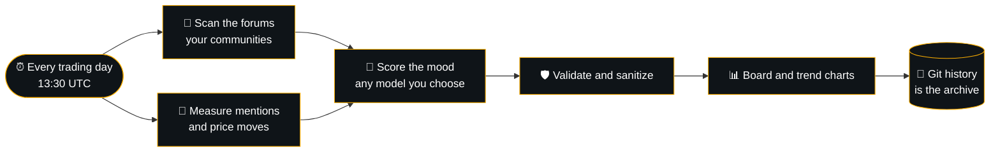

<p align="center">
  
</p>

<p align="center">
  <b>The stocks retail is piling into, ranked every trading day.</b><br>
  Measured mentions · Mood-scored · Rank moves · Updated every weekday
</p>

<p align="center">
  <a href="https://github.com/bernhardbrugger/what-reddit-is-buying/actions/workflows/daily_update.yml"></a>
  
  
  <a href="LICENSE"></a>
</p>

---

## Today's board

<!-- RANKING:START -->


<sub>Updated Monday, 16 Nov 2026 · 22:59 UTC</sub>

> **Dow Jones** 🔴 ▼ 1.41% · **S\&P 500** 🔴 ▼ 1.92% · **Nasdaq** 🔴 ▼ 2.49% · **Russell** 🔴 ▼ 1.70% · **VIX** 🟢 ▲ 18.70%

| # | Move | Ticker | Mentions 24h | Mood | Price | Theme | Signal |
|--:|:-:|:--|--:|:--|--:|:--|:--|
| 1 | – | **NVDA**<br><sub>NVIDIA</sub> | 1,200<br><sub>🔥 +187%</sub> | – | 🔴 ▼ 4.1% | – | – |
| 2 | ▲3 | **MU**<br><sub>Micron Technology</sub> | 114<br><sub>🔥 +612%</sub> | – | 🔴 ▼ 7.6% | – | – |
| 3 | ▼1 | **AMD**<br><sub>AMD</sub> | 102<br><sub>🔥 +59%</sub> | – | 🔴 ▼ 5.6% | – | – |
| 4 | – | **NBIS**<br><sub>Nebius Group</sub> | 99<br><sub>🔥 +519%</sub> | – | 🔴 ▼ 7.6% | – | – |
| 5 | 🆕 | **GOOGL**<br><sub>Alphabet \(Google\)</sub> | 89 | – | 🔴 ▼ 4.1% | – | – |
| 6 | 🆕 | **ASTS**<br><sub>AST SpaceMobile</sub> | 78<br><sub>🔥 +388%</sub> | – | 🔴 ▼ 12.3% | – | – |
| 7 | ▲3 | **GOOG**<br><sub>Alphabet \(Google\)</sub> | 67<br><sub>🔥 +379%</sub> | – | 🔴 ▼ 3.8% | – | – |
| 8 | 🆕 | **SPCX**<br><sub>SpaceX</sub> | 67<br><sub>🔥 +49%</sub> | – | 🔴 ▼ 1.3% | – | – |
| 9 | 🆕 | **SNDK**<br><sub>Sandisk</sub> | 64<br><sub>🔥 +357%</sub> | – | 🔴 ▼ 8.6% | – | – |
| 10 | 🆕 | **AAPL**<br><sub>Apple</sub> | 53 | – | 🔴 ▼ 1.0% | – | – |


<sub>Mentions: ApeWisdom (measured) · Prices: last session, Yahoo Finance · Mood: AI-scored from forum text</sub><br>
<sub>Scanning 12 communities: r/wallstreetbets · r/stocks · r/investing · r/ValueInvesting · r/StockMarket · r/options · r/Superstonk · r/RobinHood · r/smallstreetbets · r/StocksAndTrading · r/Daytrading · r/pennystocks</sub>
<!-- RANKING:END -->

---

## How it works



**Numbers are measured, not guessed.** Mention counts and their 24h growth come from a live Reddit mention tracker, price moves from the last market session. The model only scores the mood and picks the theme, and anything it writes that reads like news, a name or a number is thrown out and replaced by a house line. Every board is a commit, so the whole history of the radar lives in this repo.

## Make it yours

Everything is controlled from one file, [`config.toml`](config.toml):

```toml
[sources]
subreddits = ["wallstreetbets", "stocks", "investing", "options", "thetagang"]  # any public subreddit
extra_sites = ["stocktwits.com"]                                                # any forum site

[data]
apewisdom_filter = "wallstreetbets"   # where mention counts are measured: all-stocks, wallstreetbets, options, ...
min_mentions = 50                     # tickers below this stay off the board

[llm]
provider = "anthropic"          # gemini · anthropic · openai · openrouter · groq · mistral · deepseek · xai
model = "claude-sonnet-5-5"
```

| Setting | What it does |
| --- | --- |
| `sources.subreddits` | Communities scanned for sentiment and context. Add or remove any public subreddit |
| `data.apewisdom_filter` | Which communities the measured mention counts come from |
| `data.min_mentions` | Minimum measured mentions to make the board |
| `data.exclude_tickers` | Tickers to skip, such as broad ETFs |
| `data.mentions` | `apewisdom` (measured) or `estimate` (model guess, marked with `~`) |
| `data.prices` | Last-session price moves on or off |
| `sources.extra_sites` | Extra forum sites, one search each |
| `sources.ticker_pulse` | One targeted search on today's top tickers. The best source of mood, on by default |
| `sources.keywords` | Words that signal trading activity |
| `sources.per_query` | Communities per search. Fewer means deeper results and more credits |
| `radar.top_n` | Tickers on the board (5 to 15) |
| `radar.language` | Language of the one-liners |
| `llm.provider`, `llm.model` | Which model scores the mood. Add `llm.fallback_model` for a backup |

The config is validated on every run. If it would need more searches than `sources.max_searches`, the run stops before it spends a single credit.

## Launch your own

1. Create a repo from this code and enable Actions.
2. Add two repository secrets: `SERPAPI_KEY` ([get one](https://serpapi.com/manage-api-key)) and `LLM_API_KEY` (the key of the provider you picked in `config.toml`).
   ```bash
   gh secret set SERPAPI_KEY
   gh secret set LLM_API_KEY
   ```
   For the default `gemini` provider, a secret named `GEMINI_API_KEY` works too.
3. Run **Actions → Daily Reddit Stock Radar → Run workflow** once. From then on it runs itself, Monday to Friday.

Searches per run: `ceil(communities / per_query)` plus extra sites, daily threads and market data. The default setup uses 4 SerpAPI credits per run.

## Run it locally

Python 3.12, the same version the workflow uses. The tests need no keys and no network:

```bash
python -m venv .venv
source .venv/bin/activate              # Windows: .venv\Scripts\activate
pip install -r scraper/requirements-dev.txt
python -m pytest -q scraper/tests      # 92 passed
```

A real run needs the two keys. Copy [`.env.example`](.env.example) to `.env` (git ignores it) and fill it in, then:

```bash
python scraper/fetch_sentiment.py
```

It spends SerpAPI credits like a scheduled run and rewrites the board in `README.md`, the graphics in `assets/` and
`data/history.json` in your working copy; it does not commit. Without keys it stops before any request:
`Missing required environment variable(s): SERPAPI_KEY, LLM_API_KEY (or GEMINI_API_KEY)`.

## Data sources

Forum text via [SerpAPI](https://serpapi.com) (Google), mention counts via [ApeWisdom](https://apewisdom.io), price moves via Yahoo Finance's public chart data, mood scoring by the model you pick. The free sources are best effort: if one is down, the board still publishes, with estimates marked `~` and blank prices instead of invented ones.

## Built to be public

Keys live only in GitHub secrets and are masked everywhere. Nobody can feed anything in: the workflow has no inputs, forks never get the secrets, and everything scraped from the web is cleaned, validated and escaped before it is published. Details in [SECURITY.md](SECURITY.md).

<details>
<summary>Run it locally</summary>

```bash
pip install -r scraper/requirements-dev.txt
python -m pytest scraper/tests          # offline, no keys needed
cp .env.example .env                    # add your own keys, never commit this file
python scraper/fetch_sentiment.py       # rewrites the board, charts and history
```

</details>

<sub>Not financial advice. Rankings are automated estimates of public chatter and can be wrong.</sub>

## Limits

- **It measures chatter, not what anyone bought.** There is no position data behind the board and no test of whether mentions or mood say anything about later prices. It is not a signal.
- **Mentions are only as complete as ApeWisdom.** Counts come from one tracker and the communities set in `data.apewisdom_filter`. If it returns fewer than 5 tickers, the board falls back to model estimates, marked `~`.
- **Mood is a model reading search snippets**, not whole threads, and it is not checked against hand-labelled posts. When the forum text has no evidence on a ticker, the model must answer 50% and "other", and the board shows `–` instead of a mood.
- **Share classes count separately.** GOOG and GOOGL are two rows, because the mention tracker counts them as two tickers.
- **Timing.** The workflow is scheduled for 13:30 UTC Monday to Friday (before the US open in winter, at the open in summer), with no US holiday calendar. GitHub starts scheduled jobs late when it is busy: the last four runs started between 20:35 and 22:58 UTC, after the US close. Treat the board as end-of-day, not pre-market.
- **A failed run keeps the old board.** If a source or the model fails, nothing is overwritten; the "Updated" line shows how old the board is.
- **Tests run locally only.** `pytest` covers config, sources, model adapters, sanitizing and rendering offline; the scheduled workflow runs the scraper, not the tests.

## License

[MIT](LICENSE)
