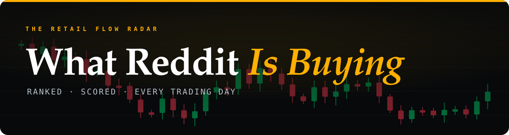
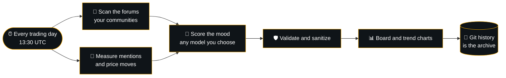

<p align="center">
  
</p>

<p align="center">
  <b>The stocks retail is piling into, ranked every trading day.</b><br>
  Measured mentions · Mood-scored · Rank moves · Fresh before the US open
</p>

<p align="center">
  <a href="https://github.com/bernhardbrugger/what-reddit-is-buying/actions/workflows/daily_update.yml"></a>
  
  
  <a href="LICENSE"></a>
</p>

---

## Today's board

<!-- RANKING:START -->


<sub>Updated Friday, 13 Nov 2026 · 07:58 UTC</sub>

> **Dow Jones** 🔴 ▼ 0.36% · **S\&P 500** 🔴 ▼ 0.35% · **Nasdaq** 🔴 ▼ 0.39% · **Russell** 🔴 ▼ 1.66% · **VIX** 🟢 ▲ 6.92%

| # | Move | Ticker | Mentions 24h | Mood | Price | Theme | Signal |
|--:|:-:|:--|--:|:--|--:|:--|:--|
| 1 | · | **NVDA**<br><sub>NVIDIA</sub> | 2,472<br><sub>🟢▲ +22%</sub> | 🔴 45% bull | 🔴 ▼ 4.3% | 🛒 Dip buy | Retail remains deeply divided while buying calls into heavy weakness |
| 2 | · | **AMD**<br><sub>AMD</sub> | 572<br><sub>🟢▲ +21%</sub> | – | 🟢 ▲ 5.9% | – | – |
| 3 | · | **NBIS**<br><sub>Nebius Group</sub> | 428<br><sub>🔥 +86%</sub> | – | 🔴 ▼ 16.8% | – | – |
| 4 | · | **MSFT**<br><sub>Microsoft</sub> | 225<br><sub>🔥 +171%</sub> | – | 🟢 ▲ 0.4% | – | – |
| 5 | · | **HR**<br><sub>Healthcare Realty</sub> | 116<br><sub>🔥 +59%</sub> | – | 🔴 ▼ 0.5% | – | – |
| 6 | · | **MU**<br><sub>Micron Technology</sub> | 114<br><sub>🔴▼ -52%</sub> | – | 🔴 ▼ 1.6% | – | – |
| 7 | · | **TSLA**<br><sub>Tesla</sub> | 85<br><sub>🔥 +55%</sub> | ⚪ 48% bull | 🟢 ▲ 1.7% | 🚀 Momentum | Options activity reflects mixed feelings among retail accounts |
| 8 | · | **DTE**<br><sub>DTE Energy</sub> | 80<br><sub>🟢▲ +8%</sub> | – | 🔴 ▼ 0.4% | – | – |
| 9 | · | **GOOG**<br><sub>Alphabet \(Google\)</sub> | 73<br><sub>🔴▼ -1%</sub> | – | 🟢 ▲ 1.6% | – | – |
| 10 | · | **AAPL**<br><sub>Apple</sub> | 72<br><sub>🔥 +71%</sub> | – | 🔴 ▼ 0.1% | – | – |

<sub>Mentions: ApeWisdom (measured) · Prices: last session, Yahoo Finance · Mood: AI-scored from forum text</sub><br>
<sub>Scanning 12 communities: r/wallstreetbets · r/stocks · r/investing · r/ValueInvesting · r/StockMarket · r/options · r/Superstonk · r/RobinHood · r/smallstreetbets · r/StocksAndTrading · r/Daytrading · r/pennystocks</sub>
<!-- RANKING:END -->

---

## How it works



**Numbers are measured, not guessed.** Mention counts and their 24h growth come from a live Reddit mention tracker, price moves from the last market session. The model only scores the mood and picks the theme, and anything it writes that reads like news, a name or a number is thrown out and replaced by a house line. Every board is a commit, so the whole history of the radar lives in this repo.

## Make it yours

Everything is controlled from one file, [`config.toml`](config.toml):

```toml
[sources]
subreddits = ["wallstreetbets", "stocks", "investing", "options", "thetagang"]  # any public subreddit
extra_sites = ["stocktwits.com"]                                                # any forum site

[data]
apewisdom_filter = "wallstreetbets"   # where mention counts are measured: all-stocks, wallstreetbets, options, ...
min_mentions = 50                     # tickers below this stay off the board

[llm]
provider = "anthropic"          # gemini · anthropic · openai · openrouter · groq · mistral · deepseek · xai
model = "claude-sonnet-5-5"
```

| Setting | What it does |
| --- | --- |
| `sources.subreddits` | Communities scanned for sentiment and context. Add or remove any public subreddit |
| `data.apewisdom_filter` | Which communities the measured mention counts come from |
| `data.min_mentions` | Minimum measured mentions to make the board |
| `data.exclude_tickers` | Tickers to skip, such as broad ETFs |
| `data.mentions` | `apewisdom` (measured) or `estimate` (model guess, marked with `~`) |
| `data.prices` | Last-session price moves on or off |
| `sources.extra_sites` | Extra forum sites, one search each |
| `sources.ticker_pulse` | One targeted search on today's top tickers. The best source of mood, on by default |
| `sources.keywords` | Words that signal trading activity |
| `sources.per_query` | Communities per search. Fewer means deeper results and more credits |
| `radar.top_n` | Tickers on the board (5 to 15) |
| `radar.language` | Language of the one-liners |
| `llm.provider`, `llm.model` | Which model scores the mood. Add `llm.fallback_model` for a backup |

The config is validated on every run. If it would need more searches than `sources.max_searches`, the run stops before it spends a single credit.

## Launch your own

1. Create a repo from this code and enable Actions.
2. Add two repository secrets: `SERPAPI_KEY` ([get one](https://serpapi.com/manage-api-key)) and `LLM_API_KEY` (the key of the provider you picked in `config.toml`).
   ```bash
   gh secret set SERPAPI_KEY
   gh secret set LLM_API_KEY
   ```
   For the default `gemini` provider, a secret named `GEMINI_API_KEY` works too.
3. Run **Actions → Daily Reddit Stock Radar → Run workflow** once. From then on it runs itself, Monday to Friday.

Searches per run: `ceil(communities / per_query)` plus extra sites, daily threads and market data. The default setup uses 4 SerpAPI credits per run.

## Data sources

Forum text via [SerpAPI](https://serpapi.com) (Google), mention counts via [ApeWisdom](https://apewisdom.io), price moves via Yahoo Finance's public chart data, mood scoring by the model you pick. The free sources are best effort: if one is down, the board still publishes, with estimates marked `~` and blank prices instead of invented ones.

## Built to be public

Keys live only in GitHub secrets and are masked everywhere. Nobody can feed anything in: the workflow has no inputs, forks never get the secrets, and everything scraped from the web is cleaned, validated and escaped before it is published. Details in [SECURITY.md](SECURITY.md).

<details>
<summary>Run it locally</summary>

```bash
pip install -r scraper/requirements-dev.txt
python -m pytest scraper/tests          # offline, no keys needed
cp .env.example .env                    # add your own keys, never commit this file
python scraper/fetch_sentiment.py       # rewrites the board, charts and history
```

</details>

<sub>Not financial advice. Rankings are automated estimates of public chatter and can be wrong.</sub>

## License

[MIT](LICENSE)
