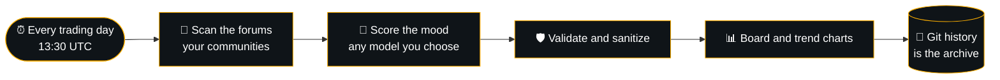

<p align="center">
  
</p>

<p align="center">
  <b>The stocks retail is piling into, ranked every trading day.</b><br>
  Mood-scored · Rank moves · Fresh before the US open
</p>

<p align="center">
  <a href="https://github.com/bernhardbrugger/what-reddit-is-buying/actions/workflows/daily_update.yml"></a>
  
  
  <a href="LICENSE"></a>
</p>

---

## Today's board

<!-- RANKING:START -->


<sub>Updated Friday, 13 Nov 2026 · 06:35 UTC</sub>

> **Dow Jones** 🔴 ▼ 0.36% · **S\&P 500** 🔴 ▼ 0.35% · **Nasdaq** 🔴 ▼ 0.39% · **Russell** 🔴 ▼ 1.66% · **VIX** 🟢 ▲ 6.92%

| # | Move | Ticker | Mentions | Mood | Day | Theme | Signal |
|--:|:-:|:--|--:|:--|--:|:--|:--|
| 1 | · | **NVDA**<br><sub>NVIDIA Corporation</sub> | 2,450 | ⚪ 48% bull | – | 🛒 Dip buy | Retail split on catching the falling knife after sharp governance selloff. |
| 2 | · | **TSLA**<br><sub>Tesla, Inc.</sub> | 320 | ⚪ 50% bull | – | 🚀 Momentum | Traders chasing volatility across short-dated puts and calls. |
| 3 | · | **RKLB**<br><sub>Rocket Lab USA, Inc.</sub> | 198 | 🟢 75% bull | – | 🚀 Momentum | Community discussion remains active as retail holds core positions. |
| 4 | · | **MSTR**<br><sub>MicroStrategy Incorporated</sub> | 145 | 🟢 65% bull | – | 🚀 Momentum | Retail interest stays elevated as crypto proxy traders hold line. |
| 5 | · | **VRT**<br><sub>Vertiv Holdings Co.</sub> | 85 | 🟢 60% bull | – | 🚀 Momentum | After-hours ticker buzz drawing eye of retail momentum seekers. |

<sub>Watching 12 communities: r/wallstreetbets · r/stocks · r/investing · r/ValueInvesting · r/StockMarket · r/options · r/SecurityAnalysis · r/pennystocks · r/Daytrading · r/thetagang · r/dividends · r/Aktien</sub>
<!-- RANKING:END -->

---

## How it works



Mentions, mood and rank moves update on their own. Every board is a commit, so the whole history of the radar lives in this repo.

## Make it yours

Everything is controlled from one file, [`config.toml`](config.toml):

```toml
[sources]
subreddits = ["wallstreetbets", "stocks", "investing", "options", "thetagang"]  # any public subreddit
extra_sites = ["stocktwits.com"]                                                # any forum site

[llm]
provider = "anthropic"          # gemini · anthropic · openai · openrouter · groq · mistral · deepseek · xai
model = "claude-sonnet-5-5"
```

| Setting | What it does |
| --- | --- |
| `sources.subreddits` | Communities on the radar. Add or remove any public subreddit |
| `sources.extra_sites` | Extra forum sites, one search each |
| `sources.keywords` | Words that signal trading activity |
| `sources.per_query` | Communities per search. Fewer means deeper results and more credits |
| `radar.top_n` | Tickers on the board (5 to 15) |
| `radar.language` | Language of the one-liners |
| `llm.provider`, `llm.model` | Which model scores the mood. Add `llm.fallback_model` for a backup |

The config is validated on every run. If it would need more searches than `sources.max_searches`, the run stops before it spends a single credit.

## Launch your own

1. Create a repo from this code and enable Actions.
2. Add two repository secrets: `SERPAPI_KEY` ([get one](https://serpapi.com/manage-api-key)) and `LLM_API_KEY` (the key of the provider you picked in `config.toml`).
   ```bash
   gh secret set SERPAPI_KEY
   gh secret set LLM_API_KEY
   ```
   For the default `gemini` provider, a secret named `GEMINI_API_KEY` works too.
3. Run **Actions → Daily Reddit Stock Radar → Run workflow** once. From then on it runs itself, Monday to Friday.

Searches per run: `ceil(communities / per_query)` plus extra sites, daily threads and market data. The default setup uses 4 SerpAPI credits per run.

## Built to be public

Keys live only in GitHub secrets and are masked everywhere. Nobody can feed anything in: the workflow has no inputs, forks never get the secrets, and everything scraped from the web is cleaned, validated and escaped before it is published. Details in [SECURITY.md](SECURITY.md).

<details>
<summary>Run it locally</summary>

```bash
pip install -r scraper/requirements-dev.txt
python -m pytest scraper/tests          # offline, no keys needed
cp .env.example .env                    # add your own keys, never commit this file
python scraper/fetch_sentiment.py       # rewrites the board, charts and history
```

</details>

<sub>Not financial advice. Rankings are automated estimates of public chatter and can be wrong.</sub>

## License

[MIT](LICENSE)
